# Nyall Negm: portfolio site

My personal portfolio: career, work case studies, an interactive platform explorer with a live BI demo, and how I
build with AI. Plain HTML, CSS and JavaScript, light and dark themes.

Live (once published): https://atlaslabshq.github.io/portfolio/ · [Platform explorer](https://atlaslabshq.github.io/portfolio/explore.html) ·
[How I work with AI](https://atlaslabshq.github.io/portfolio/how-i-work.html) (the interactive version of the diagram below)

## How a change moves (the method, as a flowchart)

```mermaid
flowchart LR
    Me(["Me (human, approves)"]) -->|brief, questions| O["Overseer<br/>plan + state document"]
    CR["Control room<br/>watches every overseer"] -.->|watches| O
    O -->|scoped slice| A["Analyst<br/>requirements, data profiling (read-only)"]
    A --> G1{{"Gate: proposal<br/>what, why, impact, backup, rollback"}}
    G1 --> B["Builder<br/>one writer per file"]
    B --> R["Reviewer<br/>independent"]
    R --> T["Tester<br/>uses it as a user would"]
    T --> G2{{"Gate: parity check<br/>key figures vs baseline"}}
    G2 -->|pass| G3{{"Gate: human sign-off<br/>this specific change"}}
    G2 -.->|fails: a number moved| B
    Me -.->|go or no-go| G3
    G3 --> RM["Release manager<br/>dry run, release, verify"]
```

## What's in it
- **Home**: career timeline, skills, featured work.
- **Explore**: an interactive map of the kind of data platform I build, from sources to the people who use it. Try the
  live BI demo, a simulated approval flow, a data question with an independent recheck, a mock order app and an agent
  control room. Names and data are invented.
- **Projects**: work case studies (details anonymised) and things I've built in my own time (repos private; code
  available on request).
- **BI demo**: an interactive executive P&L on invented data for a fictional company.
- **How I work with AI**: the method above, as an interactive diagram.

Plain HTML, CSS and JavaScript in [`docs/`](docs/), served by GitHub Pages. No build step and no frameworks.

## Preview locally
From the `docs` folder: `python -m http.server 8000`, then open http://localhost:8000/.

## Contact
nyall_negm@hotmail.co.uk · [LinkedIn](https://www.linkedin.com/in/nyall-negm/)
