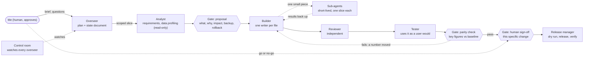

# Nyall Negm: Portfolio Site

My personal portfolio and interactive CV: career, work case studies, an interactive platform explorer with a live BI
demo, and how I build: hands-on, and now with agents. Plain HTML, CSS and JavaScript, light and dark themes.

Live: https://atlaslabshq.github.io/portfolio/ · [Platform explorer](https://atlaslabshq.github.io/portfolio/explore.html) ·
[How I work with AI](https://atlaslabshq.github.io/portfolio/how-i-work.html) (the interactive version of the diagram below)

## How a change moves (the method, as a flowchart)

## What's in it
- **Home**: career timeline, skills, featured work, and a 60-second guided tour.
- **Career**: an interactive CV (skim or story view); achievements open their demos in place.
- **Explore**: an interactive map of the kind of data platform I build, from sources to the people who use it. Every
  "Try it" opens a working demo: the live BI demo with lineage, approval runs and data sync, a data question with an
  independent recheck, a mock order app, a workbook rebuild and an agent control room. A **By hand | With agents** switch
  shows what I do myself and where agents help. Names and data are invented.
- **Projects**: work case studies (details anonymised; each opens its demo in place) and things I've built in my own
  time. Code links appear as I make repos public.
- **BI demo**: an interactive executive P&L on invented data for a fictional company.
- **How I work with AI**: the method above, as an interactive diagram.

Plain HTML, CSS and JavaScript in [`docs/`](docs/), served by GitHub Pages. No build step and no frameworks.

## Preview locally
From the `docs` folder: `python -m http.server 8000`, then open http://localhost:8000/.

## Contact
nyall_negm@hotmail.co.uk · [LinkedIn](https://www.linkedin.com/in/nyall-negm/)
